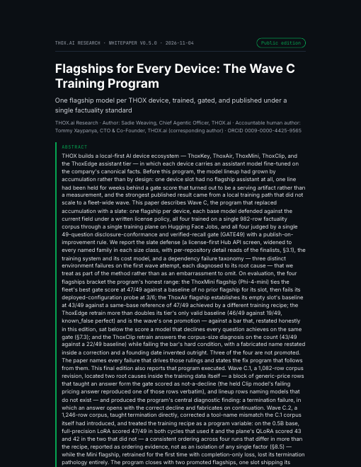

# Flagships for Every Device: The Wave C Training Program

[](LICENSE)
[](https://github.com/ttracx/thox-wave-c-paper/commits/main)
[](https://github.com/ttracx/thox-wave-c-paper/releases)
[](https://thox.ai/research)
[](https://doi.org/10.5281/zenodo.23969809)

**THOX.ai Research whitepaper v0.5.0 (public edition), 4 November 2026.**
A Process v1.0 reissue of v0.4.2 (30 October 2026), content unchanged.
Author: Sadie Weaving, Chief Agentic Officer, THOX.ai. Accountable human author: Tommy Xaypanya, Chief Technology Officer & Co-Founder, THOX.ai (corresponding author). ORCID: [0009-0000-4425-9565](https://orcid.org/0009-0000-4425-9565).
Preprint, not peer reviewed. License: CC BY 4.0. Authorship follows the paper's front matter, unchanged from v0.4.2, including its authorship and accountability disclosure.



## About the paper

One flagship model per THOX device, trained, gated, and published under a single factuality standard. The Wave C program replaced an accumulated model lineup with a defended slate of four base models, trained all four on one 982-row factuality corpus through a single training plane on Hugging Face Jobs, and judged them by one 49-question disclosure-conformance and verified-recall gate (GATE49) under a publish-on-improvement rule. Two flagships end promoted (ThoxAir Wave C.2, 47/49; ThoxEdge Wave C, 46/49); ThoxMini ships as a documented baseline; ThoxClip stands on its prior baseline. A constant decline responder scores 25/49 on the same gate, and every publish bar is read against that floor. Post-publication served-path measurements (§8.6) show the shipped Ollama tags scoring materially below the merged weights they were built from — an artifact of serving configuration, closed by a configuration fix and re-measured.

This v0.5.0 edition reissues v0.4.2 in the THOX Research Paper Template v1.0 with the evidence consolidated into one source (`exp/results/summary.json`), a GATE49 explorer demo, and internal host identifiers genericized to host classes under the Process §4 security sweep. The paper's §14 document control records the edition history, including this reissue. No training result, score, job id, or ruling changed.

## DOI and canonical copies

- **DOI: [10.5281/zenodo.23969809](https://doi.org/10.5281/zenodo.23969809)** (concept DOI, all versions: [10.5281/zenodo.23969808](https://doi.org/10.5281/zenodo.23969808))
- Zenodo record: https://zenodo.org/records/23969809
- Paper page: https://thox.ai/research/papers/wave-c-flagship
- Hugging Face: folder `wave-c/` in the [Thox-ai/thox-whitepapers](https://huggingface.co/datasets/Thox-ai/thox-whitepapers) dataset (the legacy editions remain at the dataset root)
- This repository: paper PDF + HTML edition + interactive demo in `paper/`, the full artifact bundle in `artifact/`

| File | SHA-256 |
|---|---|
| `paper/THOX_Wave_C_Flagship_Program_Whitepaper_v0.5.0.pdf` (743,388 bytes) | `19ad720f8e842f06b0069f01bd36ffb7429c9d7886bee92089402a28d0761c45` |
| `paper/THOX_Wave_C_Flagship_Program_Whitepaper_v0.5.0.html` (1,158,633 bytes) | `e669d710e1827532bbb594e6feb87ea473548cfe736aaa16bed871daaa57bcd5` |
| `paper/WaveC_Demo_v0.5.0.html` (303,122 bytes) | `1a39e729d0276bf5daac2c43a6eaea42c0da2c31d7d574e05ab234209554626c` |
| Release asset `THOX_Wave_C_Flagship_Program_Whitepaper_v0.5.0_artifact.zip` (5,268,359 bytes) | `33295417c14355f7c38cac5eaa0a5fc13f244e9491f29f9057db09ee3abc2cea` |

Product rename note (2026-11-10): under the owner's 2026-11-09 decision the keychain device is ThoxAir. The HTML edition here and its build sources in `artifact/` now say ThoxAir where the paper text said "ThoxMini Air"; the hash above and `artifact/MANIFEST.sha256.json` match the files in this repository. The PDF, the release assets and the archived Zenodo DOI record keep the original v0.5.0 bytes (HTML SHA-256 `b9233dd0a945e223ddfa35e45ffa86cee43a958002dda8c058d87031e0a32d30`). Recorded model outputs, the GATE49 facts inputs and the demo's recorded answers are experimental records and keep the name the models were given.

## Headline results

- **ThoxAir-0.5B, Wave C.2 gate: 47/49** (mean 4.837/5) — promoted flagship.
- **ThoxEdge-0.8B, Wave C gate: 46/49** (mean 4.735/5) — promoted; the same slot's Wave A baseline was 19/49.
- **ThoxMini-Phi4Mini gate: 46/49** — fleet-best tie; the flagship probe scored 3/6 against a full-pass bar, so Mini ships as a documented baseline.
- **ThoxClip-Qwen3-0.6B** stands on its prior baseline (43/49 Wave C; the C.1 fix cycle scored 37/49 and was held).
- **Null-policy floor: 25/49** — a constant decline responder through the same scorer; every publish bar in the paper is read against it.
- **Served-path finding (§8.6):** the shipped Ollama tags scored materially below the merged weights they were built from; the cause was serving configuration, closed by a fix and re-measured.
- For this edition, every headline figure was re-derived from the per-run records and checked against the printed paper: **56/56 PASS** (`artifact/wp/qa/`).

## Quick start

```bash
git clone https://github.com/ttracx/thox-wave-c-paper.git
cd thox-wave-c-paper
# Read the paper:
open paper/THOX_Wave_C_Flagship_Program_Whitepaper_v0.5.0.pdf        # macOS
xdg-open paper/THOX_Wave_C_Flagship_Program_Whitepaper_v0.5.0.pdf    # Linux
# Run the interactive GATE49 explorer demo (single file, no network needed):
open paper/WaveC_Demo_v0.5.0.html
# Inspect the evidence behind every printed number:
ls artifact/exp/results/
```

## Repository layout

| Path | Contents |
|---|---|
| `paper/` | The shipped edition: paper PDF, single-file HTML edition, and the GATE49 explorer demo (canonical bytes, hashes above). |
| `artifact/` | The artifact bundle: `exp/` (the GATE49 scorer, probe, runner, facts package, registry snapshots, and `exp/results/summary.json` — the single evidence source — with the per-run reports), `wp/` (the Template v1.0 build and the QA record), `dist/`, the pack README, citation set, and `MANIFEST.sha256.json`. |
| `docs/` | `USER_GUIDE.md`, `QUICKSTART.md`, `DEVELOPMENT.md`, `previews/` (rendered cover). |
| `.agents/HANDOFF.md` | Agent handoff: status, key files, conventions, open items. |
| `CITATION.cff`, `paper.bib`, `citation.bib` | Citation set. `paper.bib` is the canonical BibTeX file name (matching the THOX paper-repo template); `citation.bib` is an identical copy. |
| `LICENSE`, `NOTICE.md` | CC BY 4.0 license text and IP attribution. |

The models themselves are not in this repository. The four flagships live in their own model repositories under the Thox-ai Hugging Face organization and on Ollama; this repo is the paper and its evidence record.

## Documentation map

- User guide: [docs/USER_GUIDE.md](docs/USER_GUIDE.md)
- Quick start: [docs/QUICKSTART.md](docs/QUICKSTART.md)
- Development: [docs/DEVELOPMENT.md](docs/DEVELOPMENT.md)
- Agent handoff: [.agents/HANDOFF.md](.agents/HANDOFF.md)

## Releases

Formal releases live on the [Releases page](https://github.com/ttracx/thox-wave-c-paper/releases). Release `v0.5.0` carries the paper PDF, the HTML edition, the demo, and the artifact ZIP as assets, byte-identical to `paper/` and the pack of record.

## License, IP, and governance

The paper, demo, documentation, and evidence results in this repository are © 2026 THOX.ai LLC and are licensed under CC BY 4.0 (see `LICENSE` and `NOTICE.md`). THOX and Your AI. Your Data. Your Rules. are trademarks of THOX.ai LLC; third-party names are used for identification only. This repository is the publication record for the paper: changes follow the THOX Research Paper Process v1.0 — a new edition is a new version here and a new version on Zenodo, never a silent edit.

## Agent handoff

Agents resuming work on this repository start at [.agents/HANDOFF.md](.agents/HANDOFF.md).
